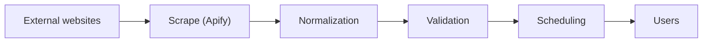

# Apify in the Internship Recommendation Platform

**Technical overview: what Apify is and how it powers the data pipeline**

---

## 1. Project Context

The platform recommends internships to students by matching their skills and interests against live listings. Those listings are spread across many websites (for example LinkedIn, Naukri, Internshala, and company career pages), and none of them offers a single, unified feed. The project therefore needs a reliable way to collect listings automatically, keep them fresh, and convert them into one consistent format. Apify is used for the first and most failure-prone step of that process: **scraping**.

---

## 2. What is Apify?

Apify is a cloud platform for web scraping, browser automation, and data extraction. Instead of running scrapers on our own servers and handling blocking, proxies, and browsers ourselves, we run them on Apify's infrastructure and receive structured data back.

| Component | What it is | Use in this project |
| :--- | :--- | :--- |
| **Actor** | A serverless program that runs on Apify's cloud and performs one job (scrape a site, crawl pages, automate a browser). | One Actor per source website (e.g., a LinkedIn jobs Actor, a Naukri Actor). |
| **Apify Store** | A marketplace of ready-made Actors for popular sites. | First place to look, so we avoid writing scrapers from scratch. |
| **Dataset** | Storage for the structured results of a run, exportable as JSON, CSV, or Excel. | Raw scraped listings land here before we pull them into our backend. |
| **Scheduler** | Runs Actors automatically on a cron-style schedule. | Triggers fresh scrapes daily or every few hours. |
| **Webhooks** | HTTP callbacks fired when a run succeeds or fails. | Notify our backend that new data is ready. |
| **Proxies** | Rotating IP addresses (datacenter and residential). | Reduce blocking when scraping many pages. |
| **Crawlee** | Apify's open-source scraping library (JavaScript/TypeScript and Python). | Used for custom Actors on sites with no ready-made scraper. |
| **API / Client** | REST API plus JS and Python clients to start runs and read results. | How our backend controls Apify programmatically. |

---

## 3. Where Apify Fits in the Pipeline

The project follows a staged pipeline. Apify owns the scraping stage; everything after it runs in our own backend.



*Highlighted stage (`Scrape (Apify)`) is handled by Apify. Source sites include LinkedIn, Naukri, Internshala, and company career pages.*

### 3.1 Step-by-step data flow

- **Trigger:** The Apify Scheduler (or our backend through the API) starts each Actor on a fixed schedule.
- **Scrape:** Every Actor visits its source site, handles pagination and dynamic content with a headless browser, and extracts raw listing fields. Proxies and retries are managed by the platform.
- **Store:** Results are written to an Apify Dataset as JSON records.
- **Notify:** When the run finishes, a webhook calls an endpoint on our backend with the run and dataset IDs.
- **Ingest:** Our backend downloads the dataset items through the Apify API and hands them to the normalization stage.
- **Downstream processing:** Normalization, validation, scheduling, and recommendation logic run outside Apify and store clean records in our own database for the website to serve.

### 3.2 Why Apify instead of building everything ourselves

| Challenge when scraping directly | How Apify helps |
| :--- | :--- |
| Sites block repeated requests from one IP | Built-in proxy rotation and fingerprint handling |
| JavaScript-heavy pages need real browsers | Managed headless Chromium (Playwright/Puppeteer) in the cloud |
| Scrapers break when a site changes | Maintained Store Actors; we can update a single Actor without touching the backend |
| Running jobs reliably on a schedule | Native scheduler, retries, logs, and monitoring |
| Servers to maintain and scale | Serverless; pay for compute used |
| Different output per site | Every Actor outputs JSON in a Dataset, giving one predictable interface |

### 3.3 Source strategy

Use a pre-built Store Actor wherever one exists and is well maintained. For smaller sites and company career pages, build custom Actors with Crawlee. Internship-focused sources such as Internshala and Unstop should be prioritized because their data is already student-oriented, while large job boards add breadth.

---

## 4. Implementation Details

### 4.1 Triggering an Actor and reading results

The backend uses the official Apify client. The example below (Python) starts an Actor, waits for it to finish, and reads the resulting listings. The Actor ID and input fields are placeholders, because each Actor defines its own input schema in its Store page.

```python
from apify_client import ApifyClient

client = ApifyClient("<APIFY_API_TOKEN>")  # keep in an environment variable

run_input = {
    "searchQuery": "software internship",   # input fields vary per Actor
    "location": "India",
    "maxItems": 200,
}

run = client.actor("<ACTOR_ID>").call(run_input=run_input)

for item in client.dataset(run["defaultDatasetId"]).iterate_items():
    save_raw_listing(item)  # send to normalization stage
```

### 4.2 Webhook-driven ingestion

Rather than polling, configure a webhook on each Actor for the **run succeeded** event. Apify then sends a `POST` request to an endpoint such as `/webhooks/apify` containing the run and dataset IDs. The endpoint should verify the request, fetch the dataset, and queue the items for processing. A second webhook on **run failed** should raise an alert so broken scrapers are noticed quickly.

### 4.3 Target data schema

Raw records differ between sites, so every listing is mapped into one schema during normalization:

| Field | Notes |
| :--- | :--- |
| `title`, `company` | Trimmed and case-normalized |
| `location`, `work_mode` | Standardized city names; remote / onsite / hybrid |
| `stipend_min`, `stipend_max` | Converted to INR per month; null if unpaid or unstated |
| `duration_months` | Parsed from text such as '2 months' or '8 weeks' |
| `skills[]` | Mapped to a canonical list (e.g. 'JS' becomes 'JavaScript') |
| `deadline`, `posted_date` | ISO dates; used to expire old listings |
| `source`, `source_url` | Always link back to the original posting |
| `fingerprint` | Hash of company + title + location, used for deduplication |

### 4.4 Validation rules applied after scraping

- Reject records missing title, company, or source URL.
- Deduplicate across sources using the `fingerprint` field, keeping the most complete record.
- Drop listings whose deadline has passed or that no longer load at the source URL.
- Flag suspicious postings (for example ones asking students for payment) for manual review.

---

## 5. Scheduling and Freshness

Internship listings change daily, so freshness matters. A sensible starting configuration:

| Source type | Suggested frequency | Reason |
| :--- | :--- | :--- |
| Internship portals (Internshala, Unstop) | Every 6 to 12 hours | New listings appear throughout the day |
| Large job boards (LinkedIn, Naukri) | Once or twice daily | High volume, higher blocking risk; keep requests modest |
| Company career pages | Daily or weekly | Change slowly |
| Stale-listing re-check | Daily | Remove closed or expired listings |

---

## 6. Cost and Performance Considerations

- **Billing:** Apify bills mainly on compute usage, and some Store Actors also charge per result. Check current pricing at apify.com and test with small `maxItems` values before scaling.
- **Targeted extraction:** Scrape only the fields you need and avoid re-scraping unchanged pages, which lowers cost and blocking risk.
- **Proxies:** Residential proxies are more reliable but more expensive than datacenter proxies; use them only for sources that need them.
- **Replayability:** Store raw dataset output for a short period so normalization bugs can be fixed and replayed without scraping again.

---

## 7. Risks and Responsible Use

- **Terms of service:** Some sites, LinkedIn in particular, restrict automated scraping. Using a third-party Actor does not remove this risk. Prefer official APIs, partnerships or sources that permit scraping, and review each site's terms and robots.txt before adding it.
- **Data minimization:** Collect only public listing information. Do not collect personal data of recruiters or applicants.
- **Attribution:** Show a short summary and link to the original posting rather than republishing full content.
- **Fragility:** Scrapers break when sites change layout. Monitor run failures and keep fallback sources so the platform still shows listings if one scraper is down.

---

## 8. Summary

Apify gives the project a managed, scalable scraping layer. Actors collect raw listings from many sites, Datasets store them, and the Scheduler and webhooks keep the data flowing into our backend. From there, our own services normalize, validate, and schedule the data so students always see clean, current internship recommendations. This lets the team spend its effort on the recommendation logic rather than on maintaining scraping infrastructure.

### Suggested next steps

1. Choose the first three sources and test their Store Actors with small runs.
2. Build the webhook endpoint and the raw-to-schema mapping for one source end to end.
3. Add validation and deduplication, then expand to the remaining sources.
